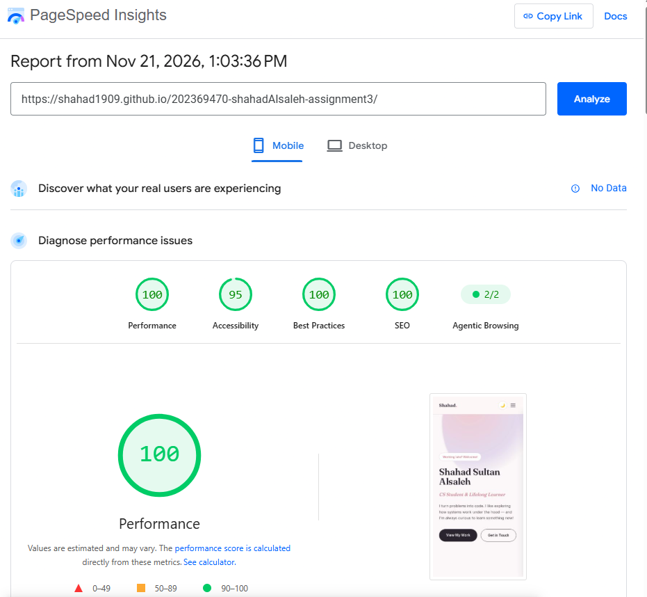
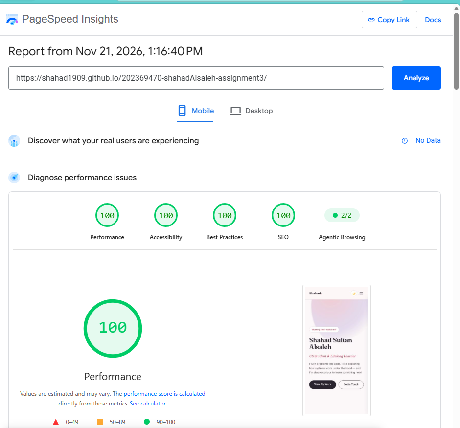
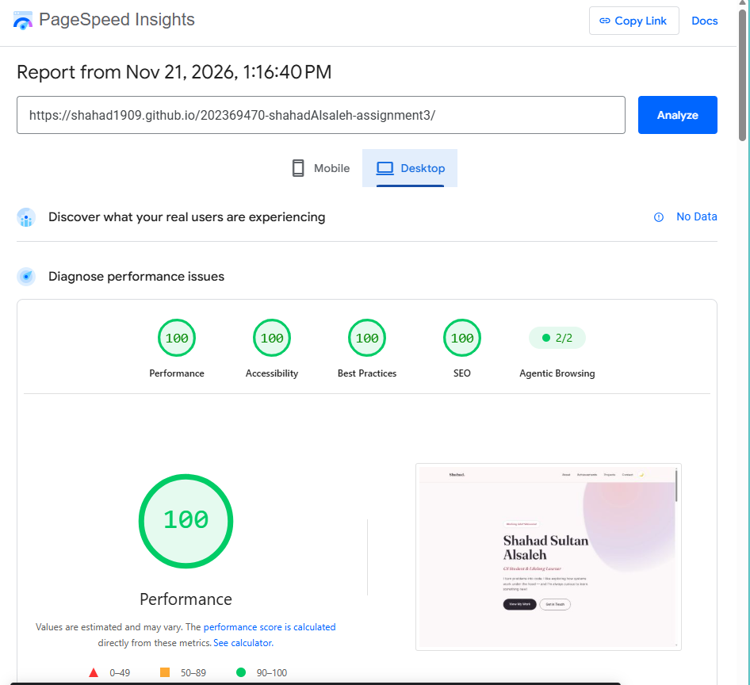

# Shahad Sultan Alsaleh — Personal Portfolio (Assignment 3)

🔗 **Live site:** https://shahad1909.github.io/202369470-shahadAlsaleh-assignment3/

## Project Description

This is my personal portfolio website, built as Assignment 3 of the web
development course. It continues the interactive portfolio from
Assignment 2 and adds **advanced functionality**: visitors can filter and
sort my projects at the same time, the site remembers their choices
between visits, each project shows its real language breakdown from the
GitHub API, and a live timer shows how long they have been on the page.
I also optimized the site with Lighthouse, reaching **100** in all four
categories on both mobile and desktop.

The site is built with plain **HTML, CSS, and JavaScript**, with no
frameworks, libraries, or backend.

### Sections
- **About Me**: a short introduction, background, skills, and hobbies.
- **Achievements**: academic honors and test scores.
- **Projects**: three featured projects that can be filtered by category
  and sorted, each with live GitHub info, a language breakdown,
  expandable details, and a GitHub link.
- **Contact**: a form (Name, Email, Message) with client-side validation.

---

## What's New in Assignment 3

| Feature | What it does | How to try it |
|---|---|---|
| **Filter + sort projects together** | Filter buttons (All, Software, Hardware, Machine Learning) and a sort menu (Newest, Oldest, Name A–Z) work at the same time. Projects without a GitHub date are always placed last, project numbers (01, 02, 03) follow the current order, and a message appears if no project matches. | Click **Hardware**, then change **Sort by**: only the hardware project stays, in the chosen order. |
| **Remembered choices** | The selected filter and sort are saved in `localStorage` and restored on the next visit, but only if they are still valid options. The theme uses the same shared save/read functions. | Choose **Software** and **Oldest first**, then refresh the page. |
| **Language breakdown (GitHub API)** | Each project shows the percentage of each programming language in its repository (top 3, with the rest grouped as "Other"), calculated from a second GitHub API request. If this request fails, the line is simply hidden. | Look under the dates of each project, e.g. `Java 100.0%`. |
| **Visit timer** | The footer shows how long you have been on the page (e.g. `2m 05s`). It is calculated from the start time, so it stays correct even when the tab is in the background. | Scroll to the footer and wait a few seconds. |
| **Performance & accessibility** | Only the font weights in use are loaded, servers are preconnected, a forced layout calculation was removed, light-mode colors were darkened to meet WCAG AA contrast, and the content is wrapped in a `<main>` landmark. | See the Lighthouse results below. |

### Features carried over from Assignments 1 and 2
- Fully responsive layout (desktop, tablet, mobile) using CSS Flexbox and Grid.
- Dark / light theme saved in `localStorage`.
- Live GitHub repository dates, with a loading state and a friendly
  error message with a **Try again** button.
- Expandable project details ("Biggest challenge" / "What I learned").
- Contact form with live validation, a character counter, and a shake
  animation for invalid fields.
- Smooth scrolling, time-of-day greeting, and a mobile hamburger menu.

### Accessibility
- All interactive elements are real `<button>` elements, so they work
  with the keyboard (Tab, then Enter or Space). Filter buttons and the
  sort menu show a clear outline when reached with the keyboard
  (`:focus-visible`).
- `aria-expanded`, `aria-controls`, `aria-pressed`, `aria-label`, and
  `aria-live` tell screen-reader users what each button does, which
  filter is selected, and when content changes.
- Light-mode text colors meet the **WCAG AA** contrast ratio (at least
  4.5:1), and the page content is inside a `<main>` landmark, so screen
  readers can jump straight to it.
- All animations are turned off for users who enable "reduce motion" in
  their device settings.

---

## Lighthouse Results

Tested with [PageSpeed Insights](https://pagespeed.web.dev) on the live site.

| | Performance | Accessibility | Best Practices | SEO |
|---|---|---|---|---|
| Mobile, before optimizing | 100 | 95 | 100 | 100 |
| **Mobile, after** | **100** | **100** | **100** | **100** |
| **Desktop, after** | **100** | **100** | **100** | **100** |

| Mobile before | Mobile after | Desktop after |
|---|---|---|
|  |  |  |

The Performance score can change slightly between runs (I saw 98–100),
because it depends on network speed at the time of the test.

---

## Setup Instructions

### Option 1: Open the live site
Visit https://shahad1909.github.io/202369470-shahadAlsaleh-assignment3/.
Nothing to install.

### Option 2: Run locally
No installation or build tools are required. This is a static website.

1. **Clone** this repository:
   ```bash
   git clone https://github.com/shahad1909/202369470-shahadAlsaleh-assignment3.git
   ```
2. **Navigate** into the project folder:
   ```bash
   cd 202369470-shahadAlsaleh-assignment3
   ```
3. **Open `index.html`** in your browser:
   - Double-click the file, **or**
   - Right-click it, choose "Open with", and pick your browser, **or**
   - Use the VS Code **Live Server** extension for auto-reload while editing.

> **Notes:**
> - An internet connection is needed for Google Fonts and the GitHub
>   data. Without it, the site still works and shows a friendly error
>   message with a **Try again** button.
> - GitHub allows **60 API requests per hour** per network without
>   login, and each page load uses 6. If you refresh many times, the
>   GitHub info may be unavailable for a while; it comes back on its own.

---

## Project Structure

```
202369470-shahadAlsaleh-assignment3/
├── README.md
├── index.html
├── .gitignore
├── css/
│   └── styles.css
├── js/
│   └── script.js
├── assets/
│   └── images/
└── docs/
    ├── ai-usage-report.md
    ├── technical-documentation.md
    └── images/          (Lighthouse screenshots)
```

---

## Technologies Used
- **HTML5**: semantic structure (`header`, `main`, `section`, `footer`)
  and ARIA attributes for accessibility.
- **CSS3**: custom properties (variables) for theming, Flexbox, Grid,
  transitions, and `@keyframes` animations.
- **JavaScript (ES6+)**: DOM events, `localStorage`, `fetch` with
  `async/await`, `Promise.allSettled`, array methods (`map`, `sort`,
  `filter`, `reduce`, `slice`, `includes`), and `setInterval`.
- **GitHub REST API**: public repository data and language statistics
  (no authentication needed).
- **Google Fonts**: Fraunces (headings) and Inter (body text).
- **GitHub Pages**: hosting for the live site.
- **PageSpeed Insights / Lighthouse**: performance and accessibility testing.

Full technical details are in
[`docs/technical-documentation.md`](docs/technical-documentation.md).

---

## AI Usage Summary

I used **Claude (Anthropic)** as a step-by-step tutor throughout this
assignment. Claude explained each feature in Arabic first, then gave me
the code with blanks that I filled in myself, and reviewed my answers
before each commit. I made my own decisions along the way: I replaced
the suggested GitHub "stars" with a language breakdown because stars are
not meaningful for student projects, chose `Promise.allSettled` instead
of the suggested `Promise.all`, noticed a misplaced bracket myself from
the editor's error highlighting, and fixed duplicated code that Claude
found during review. All AI-assisted commits are
marked with `Assisted-by: Claude (Claude Opus 5.5)`.

Getting the explanation first gave me a clear picture of the concept before I had to apply it, so when I filled in the blanks I understood why each answer was correct instead of just guessing.

A full breakdown of tools used, benefits, challenges, learning outcomes,
and the usage log is available in
[`docs/ai-usage-report.md`](docs/ai-usage-report.md).

---

## Author

**Shahad Sultan Alsaleh** (Student ID: 202369470)